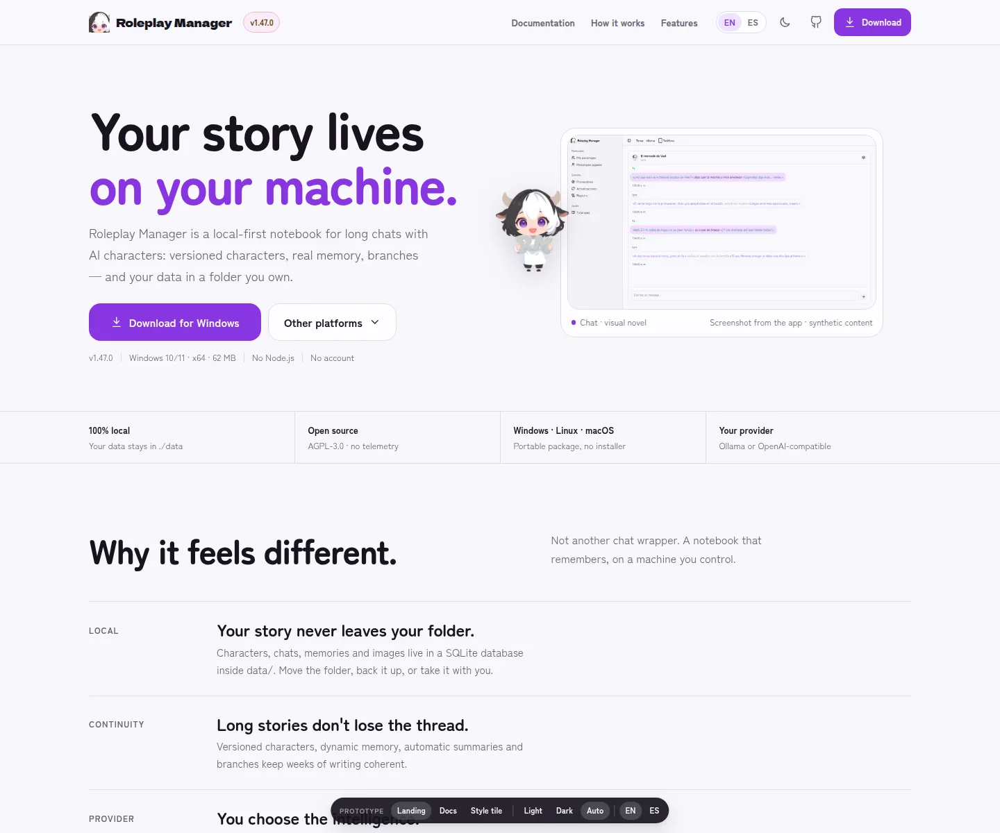
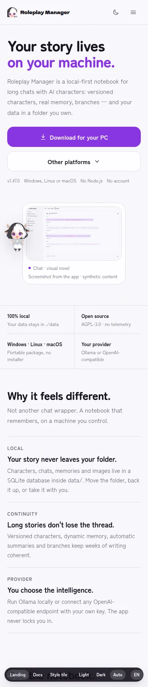
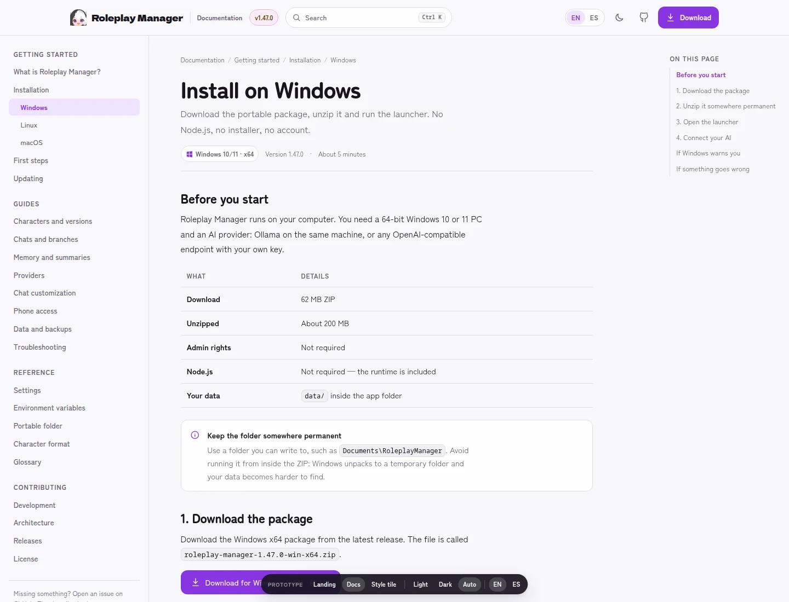
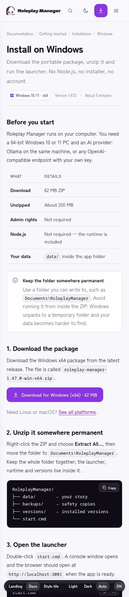

# Sitio web — roleplay-manager.com

**Fecha:** 2026-10-23.
**Estado:** S82–S84 implementados y desplegados en `roleplay-manager.com`; pendiente la revisión final en iPhone/Safari.

Este directorio reúne la investigación, las decisiones de diseño y el plan técnico
para el sitio público de Roleplay Manager. No sustituye a `PRODUCT.md` ni a
`DESIGN.md`: los usa como fuente de verdad.

## Documentos

| Archivo                                                        | Qué contiene                                                                                                                           |
| -------------------------------------------------------------- | -------------------------------------------------------------------------------------------------------------------------------------- |
| [`research.md`](./research.md)                                 | Análisis de GameNative y SillyTavern, hallazgos de UX móvil, detección de idioma y auditoría del contenido existente.                  |
| [`design.md`](./design.md)                                     | Concepto «El cuaderno abierto», mapa del sitio, portada sección a sección, UX de descarga, IA de documentación y sistema visual.       |
| [`implementation.md`](./implementation.md)                     | Cloudflare Pages, dominio y DNS, stack Astro/Starlight, publicación de releases, rendimiento, SEO, plan S82–S84 y checklist de salida. |
| [`../prototypes/site.html`](../prototypes/site.html)           | Prototipo de la portada.                                                                                                               |
| [`../prototypes/site-docs.html`](../prototypes/site-docs.html) | Prototipo de una página de documentación.                                                                                              |
| [`../prototypes/site.css`](../prototypes/site.css)             | Tokens y estilos de la portada.                                                                                                        |
| [`../prototypes/site-docs.css`](../prototypes/site-docs.css)   | Estilos del layout de documentación.                                                                                                   |
| [`../prototypes/site.js`](../prototypes/site.js)               | Idioma, tema, detección de SO, diálogos, galería, búsqueda y copia.                                                                    |

## Vista rápida

| Portada — escritorio (1440 px)                               | Portada — móvil (390 px)                            |
| ------------------------------------------------------------ | --------------------------------------------------- |
|  |  |

| Docs — escritorio (1440 px)                                     | Docs — móvil (390 px)                                  |
| --------------------------------------------------------------- | ------------------------------------------------------ |
|  |  |

Capturas del prototipo, no del sitio final. La UI de la app que aparece dentro
de las capturas está en español y usa contenido sintético.

## Decisiones confirmadas y propuesta

1. **Dominio:** `roleplay-manager.com`, comprado en Cloudflare. Los NS ya
   apuntan a Cloudflare; no hay registros A/CNAME configurados todavía.
2. **Hosting:** Cloudflare Pages con subida directa; GitHub Actions construye
   y despliega, y el workflow de release refresca la versión descargable.
3. **Idioma:** inglés canónico en `/`; español completo en `/es/`. Si el
   navegador o la zona horaria indican una región hispanohablante, la primera
   visita cambia a español; la elección manual se recuerda.
4. **Orden de entrega:** S82 portada + descarga; S83 documentación; S84 pulido,
   capturas, dominio y automatización.
5. **Sin testimonios, prensa ni métricas inventadas.** La confianza se construye
   enseñando la app, explicando dónde viven los datos y quitando el miedo a los
   avisos del sistema.

## Cómo abrir el prototipo

No necesita build ni servidor. Abre directamente:

```bash
xdg-open docs/prototypes/site.html
xdg-open docs/prototypes/site-docs.html
```

También puedes servirlo desde la raíz del repo si el navegador bloquea rutas
relativas:

```bash
python3 -m http.server 8766
# http://127.0.0.1:8766/docs/prototypes/site.html
# http://127.0.0.1:8766/docs/prototypes/site-docs.html
```

Parámetros útiles del prototipo:

| Parámetro               | Efecto                                           |
| ----------------------- | ------------------------------------------------ |
| `?lang=en` / `?lang=es` | Fuerza el idioma.                                |
| `?dialog=platforms`     | Abre el selector de descarga.                    |
| `?dialog=search`        | Abre la búsqueda de docs.                        |
| `?q=ollama`             | Precarga una búsqueda (junto a `dialog=search`). |
| `?tab=chat`             | Abre la pestaña de chat de la galería.           |

## Limitaciones conocidas del prototipo

- Las capturas de la app están en español y son las únicas disponibles hoy. La
  versión final necesita capturas en inglés y español para cada locale.
- Las fuentes son subsets latin self-hosted copiados de Fontsource, igual que
  usará producción. No hay dependencias de Google Fonts.
- Los datos de release y los enlaces de descarga están fijados a `v1.47.0`.
  Producción los leerá de la API de GitHub en build time.
- La búsqueda de docs es una simulación local; producción usará Pagefind.
- El cambio de idioma es una demostración en una sola página. Producción usará
  rutas `/` y `/es/` con `hreflang` y contenido estático.
- El prototipo no incluye analítica, formularios, cookies ni backend.

## Validación del prototipo

- **HTML:** `npx html-validate` sin errores reales (con las reglas de estilo de
  comillas/void desactivadas; el resto pasa).
- **Impeccable detector:** sin problemas de contraste, texto diminuto ni texto
  funcional por debajo de 11 px. Quedan avisos aceptados:
  - `cramped-padding` en el primer ítem sin borde de la franja de confianza y de
    los pasos, y en secciones con padding de bloque (falsos positivos).
  - Píldoras de 999 px (chips, placas, barra de prototipo): el sistema las usa
    a propósito.
  - Mono del sistema (`SF Mono`): DESIGN.md ya define mono del sistema para
    rutas y datos.
- **Lighthouse móvil (prototipo estático):** Performance **99**, Accessibility
  **100**, SEO **100**. Best Practices quedó en **96** en la pasada registrada
  por dos 404 de variantes de imagen; las variantes ya existen y una comprobación
  con CDP confirma 0 recursos fallidos. La producción en Cloudflare debería
  mejorar caché y compresión.
- **Responsive:** sin overflow horizontal a 390 px; CTA visible en el primer
  viewport; trust en 2×2.
- **SO:** probado con UA de Windows, macOS, Linux e iPhone. Windows descarga
  directo; macOS/Linux abren el selector; móvil muestra «tu PC».
- **Idioma:** probado EN/ES, autodetección por navegador/zona horaria y
  persistencia de la elección.
- **Tema:** claro, oscuro y sistema.
- **Consola:** sin errores tras corregir los assets.

## Estado de la implementación

| Pieza                               | Estado |
| ----------------------------------- | ------ |
| Investigación y propuesta           | ✅     |
| Prototipo de portada                | ✅     |
| Prototipo de docs                   | ✅     |
| Paquete `packages/website`          | ✅ S82 |
| Proyecto Cloudflare Pages           | ✅     |
| DNS, dominio, HTTPS y HSTS          | ✅     |
| Documentación completa ES/EN        | ✅ S83 |
| 404, OG images y CTA de docs        | ✅ S84 |
| Capturas localizadas                | ✅ S84 |
| Deploy automático y release refresh | ✅ S84 |

## Próxima sesión

1. Revisar la documentación y la portada en un iPhone/Safari real.
2. Rotar el token de Cloudflare compartido durante la configuración.
3. Revisar el CTA de descarga de docs en un teléfono real.
